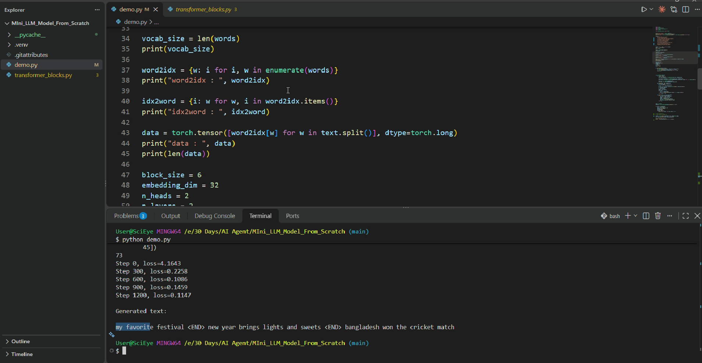

# Mini GPT from Scratch

A 28,657-parameter word-level language model built in PyTorch. Train it on 11 short sentences about Dhaka, Eid, cricket, and everyday life, then give it a few words and watch it sample a continuation one token at a time.

LLM stands for large language model. It’s a neural network trained on large amounts of text to learn patterns in language. A GPT-style LLM generates text one token at a time. A token can be a word, part of a word, or punctuation.

Your Mini GPT demonstrates this process on a small scale. When you enter my name is, the model uses attention to relate those words to each other, then calculates a probability for each possible next word. It might sample Riad, append it to the prompt, and use my name is Riad to predict the next word.

The diagram follows that example through your model’s embeddings, two Transformer blocks, and next-word prediction.


## Demo Video ( training and testing )

https://github.com/user-attachments/assets/db465505-6429-4bd0-a45c-5444043954be

Follow the original VS Code session from the training loop to the generated text. The current script uses the same corpus and prints a shorter training log.

## Images

[](assets/training-run.png)

In this run, the model continues from `my` to `favorite festival`. The `<END>` token marks the sentence boundary before the sampler continues with `new year brings lights and sweets`.

## Run it locally

You’ll need Python, pip, and a CPU. The following run was tested with Python 3.14 and PyTorch 2.15.

```sh
git clone https://github.com/riad67/MIni_LLM_Model_From_Scratch.git
cd MIni_LLM_Model_From_Scratch
python -m venv .venv
```

Activate the environment with `.\.venv\Scripts\Activate.ps1` in PowerShell or `source .venv/bin/activate` on macOS and Linux. Then install PyTorch and run the demo.

```sh
python -m pip install -r requirements.txt
python demo.py
```

Each run trains from random initialization. With the default prompt `my`, seed 42, and 1,500 training updates, one CPU run produced this continuation, including the prompt.

```text
my name is Riad Hossain <END> i love traveling and exploring new places <END> the weather
```

### Try a different prompt

```sh
python demo.py --prompt "the roads" --tokens 12 --steps 1500 --seed 7
```

Use case-sensitive words from the corpus. The sampler generates the requested number of tokens, so it can continue into another sentence after `<END>`. For a quick installation check, run `python demo.py --steps 3`.

## How it works

1. **Build the vocabulary.** Split the sentences on whitespace and append an `<END>` token to each. The training stream contains 73 tokens and 49 distinct words and markers.
2. **Create a prediction task.** Sample windows of six tokens. Shift each window by one position to form its targets. For example, the input `my name is` has targets `name is Riad`.
3. **Train the decoder.** Add learned token and position embeddings of width 32. Two Transformer blocks each apply two masked attention heads and a feed-forward network with residual connections. AdamW updates the weights using next-token cross-entropy.
4. **Sample a continuation.** Use the last six tokens of context to predict the next word. Draw from that distribution, append the sampled token, and repeat.

With only 11 training sentences, the model frequently repeats phrases it has seen. The printed loss describes a sampled training batch. There is no held-out evaluation.

## Explore the code

| File | What to look for |
| --- | --- |
| [demo.py](demo.py) | Edit `CORPUS`, follow a training batch, or step through `TinyGPT.generate()`. |
| [transformer_blocks.py](transformer_blocks.py) | Inspect the causal mask, scaled dot-product attention, and residual connections. |

